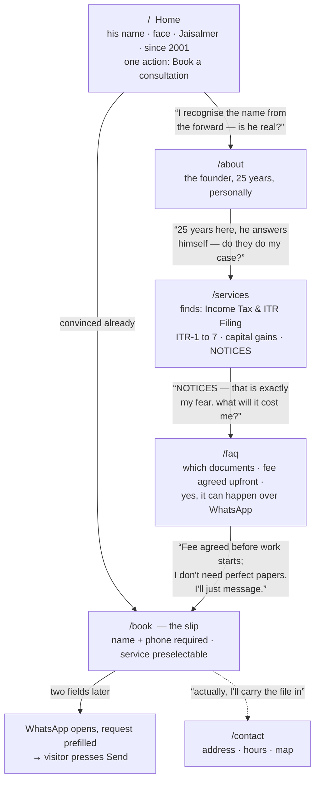
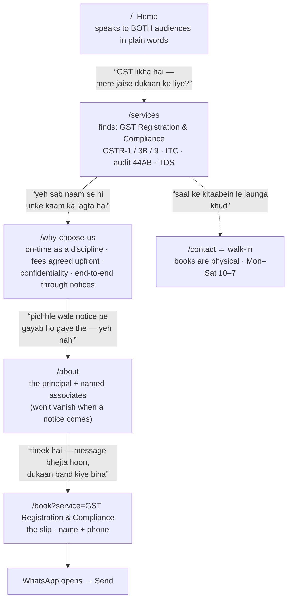

# The user problem & the conversion flow

> PROPOSAL — pending owner [GATE] approval (Phase 1)

**Lead UX Strategist (ux-strategist)** · 14 Nov 2026 · inputs: `STUDIO_CHARTER.md`, `PROJECT-NOTES.md`, `site/app/book/page.tsx`, `site/components/site/booking-form.tsx`, `site/components/site/{header,whatsapp-float,footer}.tsx`, `site/lib/site-config.ts`, `docs/design/critic/smoke-test-2026-11-13.md`, Phase 1 owner answers. Companion piece: `vibe-board.md` (The Kept Ledger). This document owns *structure and conversion*; visual treatment belongs to the Art Director.

> NOTE (Orchestrator, 14 Nov 2026): two duplicate agent runs raced on this file
> after a server restart. The reviewed version below is the canonical one; the
> discarded duplicate's nav proposal (drop /testimonials and /why-choose-us from
> the header until real testimonials arrive) is deferred to the owner at the
> [GATE], not adopted here. See `DECISION_LOG.md`.

---

## 1. Who is trying to do what, and why it is hard

Two audiences, equally weighted, one site. Both arrive on a phone, most often from a WhatsApp forward, a phone call, or a local Google search, and both must answer the same question before they act: **"Are these people careful with my papers — and will they deal with me fairly?"**

> **ASSUMPTIONS (flagged once here, they colour everything below):** most visitors are on mid-range Android phones, Hindi-first, comfortable mixing English tax vocabulary (GST, ITR, Form 16) into Hindi speech; many arrive already knowing the firm's name via word of mouth; network can be patchy so weight matters. No analytics exist yet — every behavioural claim below is an assumption until the measurement plan in §7 runs. The owner's Phase 1 answers confirm the arrival modes (WhatsApp/phone) and the dual audience; the *language and device specifics* are mine.

### 1.1 The individual (ITR, personal tax, savings)

**The problem in their words.** "Form 16 aa gaya hai — ab karna kya hai?" A salary slip in hand, a deadline that moves every year (31 July), and one background fear that dwarfs everything: *a notice.* "Notice aa gaya to sharam bhi, jhunjhuna bhi" — the dread is not just the money, it is the hassle and the embarrassment of being the person the tax department wrote to. Secondary worries: "refund milega ki nahi" (will the refund actually arrive), "kahin kuch chhut to nahi gaya" (did I miss a deduction I was entitled to — 80C, 80D, HRA), and for older clients, pension and interest income that never feels "filed properly".

**What they have already tried.** The income-tax portal themselves (abandoned halfway — "samajh nahi aaya"), a relative "who knows computers", a colleague's CA who filed it once and then never picked up the phone in July, or last year's papers still sitting in a drawer.

**Why they hesitate to contact a consultant.**
- **Fee fear, unresolved:** no price list exists in their head for tax work, so they assume a formal firm is expensive. *(ASSUMPTION: no fee list is available and none may be published — so the site must resolve fee fear with a *process* promise — "the fee is agreed with you before any work begins" — never a number.)*
- **Papers shame:** "mere documents theek nahi hain" — they fear being judged for a messy pile.
- **Impersonal-office fear:** "badi firm hai, mujh jaise vyakti ka kaam nahi karegi" — a smallfiler assumes a consultancy is for businesses, not for them.
- **The form barrier:** a "booking" sounds like a commitment with a fee attached; a WhatsApp message sounds like asking a person a question.

**What would make them send a WhatsApp message today.** A real named person with a real photo and a 2001 starting date in Jaisalmer (institutions leave, he stayed); the sentence "you speak to the principal himself, not a call centre"; a stated next step that costs nothing ("send your name and what you need — we reply and fix a time; the first conversation is about understanding your case"); and a channel they already use. The WhatsApp float and the form must feel like the *same* easy act — talking to a person — not like filing an application.

### 1.2 The small-business owner (GST, compliance)

**The problem in their words.** "GST ki date nikal gayi to fine lagta hai" — a calendar of deadlines (GSTR-1, GSTR-3B, 9) they half-keep, with penalties for every miss. The sharper fear: *a notice.* "Notice aa gaya to kaun sambhalega?" — their previous helper (the cheap local agent, the "munshi") filed returns but vanished the moment the department wrote back. Add: input tax credit they suspect they are losing ("ITC ka poora fayda nahi mil raha"), books that are a month behind, and the nagging sense that their registration or classification may be wrong.

**What they have already tried.** A local agent at the lowest fee (fine until a notice, then unreachable), doing GST themselves on the portal between customers, or ignoring compliance until a penalty made it urgent.

**Why they hesitate to contact a consultant.**
- **"Proper firm = big money":** they expect a chartered-accountancy office to price for big clients.
- **Time tax:** every visit means shutting the shop; if the process needs repeated office trips, they postpone.
- **Wounded trust:** a previous provider over-promised and under-delivered; they now discount all claims.
- **Disorganised-books embarrassment:** they fear the first meeting will open with a scolding.

**What would make them send a WhatsApp message today.** The services list naming their exact jobs in their vocabulary — *GST registration, GSTR-1 / 3B / 9 filing, input tax credit, tax audit (44AB), TDS, bookkeeping* — because recognition ("this is my problem, in my words") is the trust trigger for this audience; on-time discipline stated as a way of working; "fees agreed before work begins"; and the knowledge that documents move over WhatsApp so the shop stays open. They will also check *who else is here* — a firm with named associates (Vikram, Bhawani, Hemraj) reads as "won't collapse if one man is busy". *(ASSUMPTION: the associates' roles currently on the site are provisional interim copy — flag pending real bios, per PROJECT-NOTES.)*

### 1.3 The shared trust problem

Both audiences are buying **care**, from a person, in a small city where reputations are remembered for decades. Everything on the site either answers "will these people be careful with my papers and my money?" or it is decoration. Two facts do more answering than anything we can write: **since 2001** (25+ years, owner-confirmed) and **the founder's name and face**. Nothing invented can be allowed to dilute these two — which is exactly what the critic found on the current home page (invented testimonials with hand-coded star rows, a stats band half-costume). The conversion design in §2–§6 is built to route trust through only what is real.

---

## 2. Primary conversion goal

### 2.1 The event, defined precisely

- **Business event (the real goal):** a **confirmed consultation slot** — the firm replies on WhatsApp and fixes a time.
- **Site-observable event (what we design and can count):** the visitor **submits the booking form and WhatsApp opens with their request prefilled** (`/book` → form → `wa.me` deep link). The moment of "pressed Send inside WhatsApp" is invisible to the site — we must never pretend otherwise.
- **Secondary observable:** a tap on the floating WhatsApp button (`wa.me`, generic prefill) — a lighter commitment by a visitor who is not ready for the form.

**Success criteria (design, not numbers):**
1. The booking action is reachable in **one tap from every page** without scrolling to find it.
2. The form requires **only name + phone** (service, date, message stay optional — exactly as the current form does; do not add required fields).
3. The flow completes **one-handed on a 360 px phone**; nothing in the flow demands documents, fees, or account creation.
4. Nothing on any page asks for trust the firm hasn't earned yet — every claim traceable to an owner-confirmed fact.

### 2.2 The flow: arrival → trust → specific service → book

```
ARRIVAL            TRUST                 RECOGNITION           COMMITMENT
WhatsApp forward ─▶ "A real Jaisalmer ─▶ "They handle MY    ─▶ name + phone,
phone call         person, here since    case" (service        WhatsApp opens,
Google search      2001, his name,       names in their        message sent
shared /book link  his face"             own words)            (then the FIRM
                                                               confirms the slot)
```

The visitor does not traverse this in one visit, and does not need to: the flow must survive a single-screen impression (one trust line + one action) *and* a deliberate 3-page research path (§5).

### 2.3 The single primary CTA — semantics and placement

**Decision: one action, one wording, everywhere — "Book a consultation on WhatsApp."**

- **Verb-first, low-commitment:** "book a consultation" reads as *starting a conversation*, not "book an appointment" (which sounds formal and fee-binding) and not "get started" (template-speak). Naming the channel — *on WhatsApp* — removes the surprise of WhatsApp opening, and surprise reads as trickery to a wary audience.
- **Where each instance lives:**

| Surface | Form | Notes |
|---|---|---|
| Header (all pages) | "Book a consultation" → `/book` | Replaces the three current "Book Appointment" instances (desktop, mobile sheet, footer). |
| Floating button (all pages) | WhatsApp mark only | Self-evident channel; accessible name "Book a consultation on WhatsApp". **Static** — it must not pulse, bounce, or beg (vibe board agrees). |
| End-of-page band (every page) | Navy band: one sentence + "Book a consultation on WhatsApp" + phone as quiet text link | The one "act" surface per page (palette rule: ink = act). **One primary button per viewport** + the float; never two competing fill-buttons. |
| `/book` form submit | "Open WhatsApp with my request" | Truthful about the mechanic (currently "Send Booking Request" — fine, but the new wording kills the last surprise). |
| Deep links from `/services` | Each service entry links to `/book?service=<name>` | Preselects the service in the form. Small build change, big recognition win. |

- **Retire:** the inconsistent mix "Book an Appointment" / "Send Booking Request" / float-with-generic-text; the mailto fallback moves from an equal-width button to a quiet text link (email is the rarest channel for this audience — *ASSUMPTION* — and an equal button splits the primary action).

### 2.4 What must NOT happen (hard prohibitions)

1. **No invented social proof:** no testimonials, no names, no star rows, no "trusted by 5000+ clients", no client-logo walls. The critic's standing REJECT begins here; a rating nobody gave is a lie in gold.
2. **No fake urgency or fake counts:** no countdown timers, "only 2 slots left", live-visitor widgets, animated counters.
3. **No credentials claims:** no qualifications, memberships or badges — none are available. Founder credibility is carried by 25+ years, the role, and the face, and only those.
4. **No fee figures:** no price list, no "starting from ₹X". The fee promise is process-only ("agreed with you before work begins") — and the existing "first consultation is free" line on `/`, `/about`, `/why-choose-us` must be **verified with the owner or cut**; it is a fee commitment sitting directly on the conversion path.
5. **No hijacking:** no auto-opening chat widgets, no newsletter modals, no pre-checked boxes, no guilt copy ("most people leave here…"), no sticky bars stacking on the float.
6. **No stock photography, ever** — and no decorative imagery standing in for proof we don't have.

---

## 3. Secondary paths — when the alternatives are the *right* choice

| Path | The user for whom it is right | Where it lives |
|---|---|---|
| **Phone (tel:)** | A deadline is burning (notice received, GST date tomorrow); the form-averse; an older client who wants a voice; anyone whose WhatsApp open failed (already the SENT-card fallback). | Quiet text link inside every end-of-page navy band; the "Prefer to talk first?" card on `/book` (keep as-is); `/contact`. Never competes visually with the primary CTA. |
| **Office walk-in** | Physical, bulky paper (audit, books of account); the client who needs to see the place before handing over documents; older local clients. | `/contact` is its home: address, hours (Mon–Sat 10–7), map link. The FAQ already says routine matters complete remotely — so the site should *welcome* walk-ins, not push them. |
| **Email (mailto prefill)** | NRIs and document-senders outside chat apps. | Quiet text link only (demoted per §2.3). |

Rule: the secondary paths are **stated, never sold** — they exist so that no visitor hits a dead end, while every page's gravity still points to the one primary action.

---

## 4. Journey sketches

### 4.1 The two spines, and what each page must earn

| Page | Its one job | The click it must earn |
|---|---|---|
| `/` | **Recognise:** a real Jaisalmer firm; my job (ITR / GST) is plainly theirs | → `/services` (researching) or `/book` (convinced) |
| `/services` | **Match:** find my exact case, in my vocabulary | → `/faq` (has questions) or `/book?service=…` (ready) |
| `/about` | **Believe:** the principal is real, 25 years, answers personally | → `/book` |
| `/why-choose-us` | **Reassure:** on-time, fees agreed upfront, confidential — a way of working, not adjectives | → `/book` |
| `/faq` | **Remove the last objection:** documents, fees, online handling, notices | → `/book` |
| `/testimonials` | **(pending)** hear it from real clients — until real quotes arrive it is an honestly-marked placeholder page and **carries no journey weight** | none, until real |
| `/contact` | **Arrive:** address, hours, map, phone | walk-in or tel |
| `/book` | **Commit:** the slip; two required fields; truthful next step | the WhatsApp send |

### 4.2 Journey A — salaried individual: "Form 16 aa gaya, notice ka darr"



The decisive moment is `/faq` → `/book`: the fee answer ("you will always be told the exact fee upfront") converts fee-fear into a process promise, and the notice answer converts shame into "don't panic, don't ignore it". That pair of answers is the strongest conversion copy the firm already owns — it must sit on the research path, not buried.

### 4.3 Journey B — shop owner: "GST ki date, aur notice ka khauf"



For this audience the order differs deliberately: recognition → *way of working* → *the people* → commitment. The founder page earns the click from a burned-before buyer; the associates (once real roles/bios arrive) are what make "won't vanish" credible.

---

## 5. Content hierarchy — what the fold must carry

### 5.1 Home, above the fold (mobile 360–430 px, first ~2 screens)

In priority order, nothing else beside them:

1. **Identity line:** P.L. Sharma & Co. · Tax Consultants & Financial Advisors · Jaisalmer · **since 2001**. (All four are owner-confirmed facts; together they do more trust work than any sentence.)
2. **One plain-spoken sentence** that names the visitor's job without jargon-pile — for both audiences in one breath, e.g. the shape "Income tax and GST, handled personally — for individuals and businesses in Jaisalmer." *(wording to be written in Phase 2; structure is the decision here: it must name ITR-tax and GST, name personal handling, name the place.)*
3. **The primary CTA:** "Book a consultation on WhatsApp" — plus the phone number as quiet text.
4. **One real proof line:** "You speak to the principal himself, not a call centre." (true, distinctive, and answers the biggest shared fear in six words).

**Deliberately below the fold:** the stat band (after the critic's verdict, at most three honest tiles), services grid, why-choose grid, testimonials (placeholder-marked), FAQ preview. The founder photo belongs in the fold **only if** the art director's interim grade makes it neutral; otherwise type-only — per the vibe board, a hero with no portrait is more trustworthy than a party photo in a suit-shaped frame. Also fix the founder-card dead end: the photo/name links to `/about` (critic required-fix).

### 5.2 `/book`, above the fold (mobile)

1. **The honest next-step line, before the form:** "Fill in two details — WhatsApp opens with your request ready. We reply and confirm a time; nothing is booked automatically." *(Assumption-free, mechanically true, and it pre-answers the form's only real surprise.)*
2. **The form itself, in the first viewport:** name + phone (required), service, date, message (optional — unchanged), submit "Open WhatsApp with my request".
3. **The three steps** as short margin notes beside/above the form — *1 your name · 2 when suits you · 3 send on WhatsApp* — not a card the visitor must scroll to on mobile.

**The Kept Ledger language, where it earns conversion:** the form is rendered as **the consultation slip** — a ruled entry on the sand surface, margin rail carrying the three steps — because a form that looks like *a record being kept* answers the audience's core question ("will these people be careful with my papers?") better than any reassurance copy. The post-submit SENT state reads like an entry noted, not a marketing success screen: **"Request noted — we will confirm your slot on WhatsApp."** with the existing call-fallback and reset. Placeholders adopt the vibe board convention exactly: dashed rule + visible `[PLACEHOLDER — awaiting real testimonial from owner]` in brass-ink; no names, no stars, no invented quotes anywhere. Content decisions here are independent of the metaphor — if the slip device fails usability, the field set and wording above still stand.

### 5.3 Available vs pending — and how pending is marked

| Content | Status | Rule on the site |
|---|---|---|
| Founder name, photo*, 25+ years, since 2001 | **Available** (*photo exists; neutral reshoot requested per vibe board §7) | Carries the fold and `/about`. No caption beyond what is true. |
| Services (6, named), hours, address, phone, WhatsApp, map | **Available** | The recognition layer — exact vocabulary on `/services`. |
| Real testimonials | **Pending (promised)** | Placeholder-marked entries only; `/testimonials` carries zero journey weight until real quotes with permission arrive. |
| Team photos (Vikram, Bhawani, Hemraj) | **Pending** | Dashed-rule placeholder plates, or name-only entries — never stock faces. |
| Team roles / bios | **Interim copy** | Marked for replacement (already flagged in `site-config.ts`); no invented credentials. |
| Founder qualifications | **NOT available** | Nothing claimed anywhere. Years + role + face carry credibility. |
| Fee list | **NOT available** | No numbers; the fee promise is process-only. Verify-or-cut the "first consultation free" line (§2.4). |

---

## 6. Measurement — what would tell us the flow works

**No analytics exist today. Nothing below is a number; it is an instrumentation plan with an honest baseline-first philosophy.**

**Events (site-observable):**
- `book_submit` — form valid → WhatsApp opened with prefilled request (the primary observable event, §2.1).
- `wa_float_tap` — floating button used (lighter-intent signal).
- `tel_tap` — phone link used (secondary path working).
- `book_view` — arrivals on `/book`, with the referring path (which page actually funnels).

**Ground truth (not observable by the site, and decisive):** the firm's own WhatsApp is the system of record. Proposal: a simple manual log — each confirmed booking noted as *website / phone-call / walk-in / referral*. One line per client, kept by whoever replies. This costs nothing and answers the only question that matters: **how many consultations trace back to the site.**

**Instrumentation choice (owner's call, logged either way):** Option A — free page-analytics with custom events (e.g. Vercel Web Analytics free tier; third-party script, so it needs owner approval per charter). Option B — zero scripts: manual log + the firm asking each new WhatsApp client "aapko website kaise mili?" (one natural question in an existing conversation). Recommend **B first, A later** if patterns are unclear; it keeps the site script-free and the data human-verified.

**Honest limitations, stated up front:** we can never see "pressed Send inside WhatsApp" from the site; cross-device journeys are opaque; a WhatsApp-forward arrival looks like a direct visit. Measure coarsely, interpret qualitatively, never invent precision.

**What success looks like (qualitative, first 4–6 weeks post-launch = baseline period):** the manual log shows the first confirmed bookings traced to the site; `book_view`→`book_submit` behaves sensibly across phone and desktop; `tel_tap` and float taps appear from pages whose band exists; and — the real test — the founder reports the website requests arriving feel like *the right kind* of client (real cases, not spam). Targets and thresholds are set **after** the baseline, with the owner, not before.

---

## 7. Summary of decisions (for the Orchestrator to log)

1. One action everywhere: **"Book a consultation on WhatsApp"**; header → `/book`, static float, one navy end-of-page band per page, form submit "Open WhatsApp with my request".
2. `/book` stays a two-required-field slip; add `?service=` preselect deep links from `/services`.
3. Trust spine routes through `/about` (founder, 25 years) and `/faq` (fees-agreed-upfront, notice reassurance); `/testimonials` carries zero journey weight until real quotes arrive, placeholder-marked.
4. Founder-card dead end fixed (links to `/about`); hero carries only owner-confirmed facts; "first consultation free" is verify-or-cut.
5. Pending content (testimonials, team photos, real roles) renders as visible dashed placeholders — a trust feature, not a gap.
